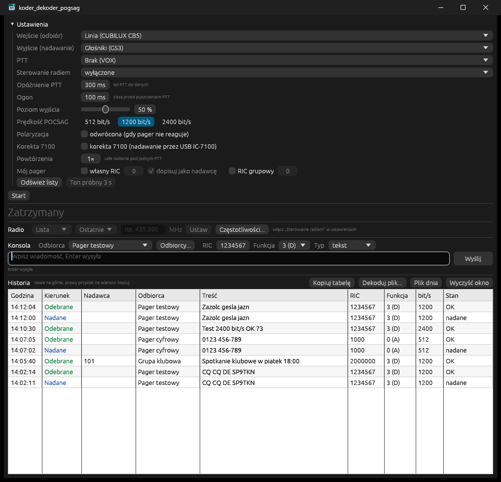

# POCSAG encoder & decoder for Windows (koder_dekoder_pogsag)

> [!IMPORTANT]
> **🇵🇱 This program is in Polish.** The window, menus and messages are in Polish only.
> Polish documentation: [README.pl.md](README.pl.md)

Transmit and receive **POCSAG pager messages (512 / 1200 / 2400 bps)** through a sound card and a radio.
The window has a console for typing messages and a history table of sent and received pages below it.
Each day's history is also saved to a text file next to the program.



## Features

- **Encoder:** text, numeric and tone-only pages, function 0–3 (A–D), all three speeds, normal or
  inverted polarity, up to 8 queued messages sent in one transmission (one preamble), estimated air time,
  Polish letters converted to ASCII for pagers.
- **Decoder:** live from the sound card or from a file (WAV, MP3, FLAC, OGG); adaptive equalizer with
  decision feedback for radio audio (high-pass / de-emphasis), noise sieve against false addresses,
  robust against lost sound-card packets (10 ms gaps). Own transmissions heard back are marked.
- **PTT:** VOX, COM port DTR / RTS / both (also inverted), Icom CI-V or Yaesu CAT. PTT is always
  released after data and tail, on abort, on sound-card error, on timeout and when the program closes.
- **Radio tuning over CAT** (Icom CI-V, Yaesu `FA`): frequency list, last 8 frequencies, typed MHz;
  the CAT port is opened only for the change, so other programs can share it.
- **My pager:** own RIC and group RIC — received pages to them are highlighted, the taskbar blinks;
  optional sender prefix `(1234567) text`, sender column in the history.
- **Recipients book** (`odbiorcy.txt`) and **frequency list** (`czestotliwosci.txt`) — editable in the
  program or in Notepad.
- **History table** like a spreadsheet: drag to reorder columns, copy row / text / RIC / whole table
  (tab-separated, pastes into a spreadsheet), daily file `historia_POCSAG_YYYY-MM-DD.txt` reloaded on start.
- **Test tone 3 s** (preamble only, with PTT) for setting level and deviation.
- Transmit correction for the IC-7100 USB audio path (pre-emphasis and low cut compensation).

| PTT mode | What it does |
|---|---|
| None (VOX) | audio only |
| COM: DTR / RTS line | line up while transmitting; "inverted" for active-low keying |
| COM: DTR+RTS | both lines at once; "inverted" applies to both |
| Icom CAT (CI-V) | `FE FE <addr> E0 1C 00 01 FD` / `... 00 FD`; IC-7100 = 88h |
| Yaesu CAT | `TX1;` / `TX0;` (FT-991A, FTDX10) |

Best results when transmitting through the radio's flat DATA input (9600 / DATA): the microphone input
has a high-pass filter and pre-emphasis, and 512 bps contains long runs of identical bits.

## Download

Windows x64 build in **[Releases](../../releases)** — a single `.exe`, no installation and no DLLs.
Settings are stored in `%APPDATA%\koder-dekoder-pogsag.txt`; the recipients book, frequency list and
daily history files are kept next to the `.exe`.

## Building

Rust toolchain `x86_64-pc-windows-gnu`; `C:\msys64\mingw64\bin` (MSYS2: dlltool, windres) must be in `PATH`:

```
cargo test --release --lib
cargo build --release --bins
```

Tests cover the encoder (code words, frames, Polish characters), encoder → decoder over a flat path and
a simulated radio path (all speeds, both polarities, 44.1 and 48 kHz), 10 ms sample loss without false
addresses, the daily file round trip and the decoder. Reports:
`cargo test --release --lib raport -- --ignored --nocapture` (sensitivity vs. noise, noise after
transmission, lost samples).

Examples (`examples/`): live loop test through a virtual cable and a com0com pair (`petla.rs`), CAT
frequency setting (`czest.rs`, `czest_silnik.rs`), decoding files (`dekoduj.rs`), decoder window timing
(`czas_okna.rs`).

## Legal

Transmit only with an amateur radio licence, on frequencies you are allowed to use. Receiving and
publishing other people's pager messages may be restricted by law in your country.

## License and credits

[GPL-3.0](LICENSE) © 2026 SP9TKN.
Libraries: [egui / eframe](https://github.com/emilk/egui), [cpal](https://github.com/RustAudio/cpal),
[symphonia](https://github.com/pdeljanov/Symphonia), [hound](https://github.com/ruuda/hound),
[serialport](https://github.com/serialport/serialport-rs), [rfd](https://github.com/PolyMeilex/rfd).

**Tools:** developed with [Claude Code](https://claude.com/claude-code) (Anthropic) — AI assistant used
for coding, testing and documentation.
